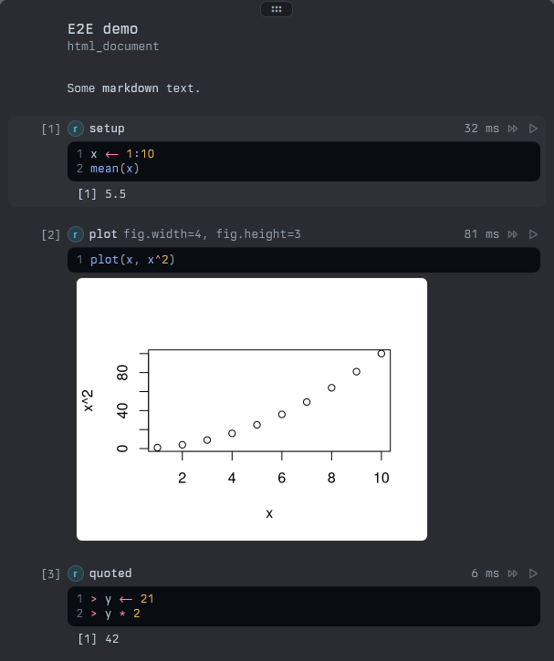

# R Notebook for Tern

Opens R Markdown (`.Rmd`) files in Tern as notebooks, the way Jupyter opens `.ipynb`
files. Markdown is rendered, chunks are editable code with line numbers, and running a chunk shows its
output right under it: printed text, messages, warnings and errors, plots, and data frames as paged
tables. All chunks share one live R session, so objects carry over from chunk to chunk like they do in
RStudio.



The file on disk stays plain R Markdown. The notebook keeps the text byte for byte, line endings
included, and only rewrites the chunks you edit, so you can knit it with `rmarkdown` as usual and
RStudio opens it exactly as before.

## Install

You need **Tern** and **R 4.0 or newer**, on Linux or macOS (on Windows, run Tern inside WSL).

The quickest way is the installer. It checks R, offers to install the R packages the notebook needs
into your personal R library (no root needed), and installs the plugin:

```sh
git clone https://github.com/betizzel/tern-rmd
cd tern-rmd
./install.sh
```

Or install the plugin with Tern alone, then the R packages from R:

```sh
tern plugin install github.com/betizzel/tern-rmd
```

```r
install.packages(c("evaluate", "jsonlite"))   # running chunks
install.packages("rmarkdown")                 # knitting (optional)
```

Knitting also needs [Pandoc](https://pandoc.org/installing.html), which RStudio ships with.
Run `Rscript deps.R` in the plugin's folder at any time to see what's installed.

| To | Run |
| --- | --- |
| Update | `tern plugin install github.com/betizzel/tern-rmd --force`, or `git pull && ./install.sh` |
| Remove | `tern plugin remove rmd` |
| Work on the plugin | `./install.sh --link` (Tern uses this folder in place) |

## Open a notebook

- `tern open homework.Rmd` in any pane, or open the file from the Files pane or the palette.
- **New R Notebook block** in the palette lists the folder's `.Rmd` files (`n` creates `Untitled.Rmd`).
- Click the file name in the status bar to open the raw `.Rmd` in a file block. A `.Rmd` path you click
  in a terminal also opens as text.

R starts the first time you run a chunk, never when a notebook merely opens.

## Keys

The keys follow Jupyter's command and edit modes, with RStudio's shortcuts on top. Press `?` in the
notebook to see this list.

**Command mode** (`Esc`):

| Key | Does |
| --- | --- |
| `Enter` | Edit the cell |
| `Shift+Enter` | Run the cell, then select the next one |
| `Ctrl+Enter` | Run the cell |
| `Alt+Enter` | Run the cell, then insert a chunk below |
| `j` `k` / `↓` `↑` | Select the next / previous cell |
| `a` / `b` | Insert a chunk above / below |
| `Ctrl+Alt+I` | Insert a chunk below and start typing in it |
| `m` / `y` | Turn the cell into Markdown / R |
| `d d` | Delete the cell (`z` brings it back) |
| `x` `c` `v` `V` | Cut, copy, paste below, paste above |
| `Alt+↑` / `Alt+↓` | Move the cell up / down |
| `l` | Edit the chunk's label and options (`r setup, fig.width=8`) |
| `o` / `O` | Hide or show the outputs / clear them |
| `R` / `P` (or `Ctrl+Alt+R` / `Ctrl+Alt+P`) | Run every chunk / every chunk above this one |
| `i i` / `0 0` | Interrupt / restart R |
| `e` | Environment: the objects in the R session |
| `s` or `Ctrl+S` | Save |
| `K` or `Ctrl+Shift+K` | Knit (renders with the `output:` from the header) |

**Edit mode**:

| Key | Does |
| --- | --- |
| `Esc` | Back to command mode |
| `Shift+Enter` | Run the chunk, then select the next cell |
| `Ctrl+Enter` | Run the current line or the selection, as in RStudio |
| `Ctrl+Shift+Enter` | Run the whole chunk |
| `Tab` | Complete the name before the caret. The list also opens on its own while you type; `↑` `↓` pick, `Tab`/`Enter` accept |
| `Alt+-` / `Ctrl+Shift+M` | Insert `<-` / `\|>` |
| `Ctrl+Shift+C` or `Ctrl+/` | Comment or uncomment lines |
| `Ctrl+Z` / `Ctrl+Shift+Z` | Undo / redo (a word at a time) |
| `↑` on the first line, `↓` on the last | Move into the neighbouring cell |

You can also use the mouse: click a cell to select it, double-click it to edit it, and use the ▶ and ⏩
buttons on a chunk to run it or every chunk above it. The status bar shows R's state; click it to
interrupt R while it runs, or to start it again after it stopped.

## Behaviour worth knowing

- **Saving.** Edits are saved 1.5 s after you stop typing. If another program changes the file while the
  notebook has no unsaved edits, the notebook reloads it and keeps the output of every chunk whose code
  didn't change.
- **Outputs** are kept in the plugin's data folder (`~/.local/state/tern/plugin-data/rmd`), not in the
  `.Rmd`, so they come back when you reopen the notebook. Knitting writes them into the HTML; an
  `html_notebook` header produces the `.nb.html` many courses ask for.
- **The R session.** Each notebook gets its own session, started in the `.Rmd`'s folder, so
  `read.csv("data.csv")` finds files next to the notebook. The session survives plugin reloads. It stops
  when you close the notebook, and if Tern goes away first it exits on its own after two idle minutes.
  An error stops the chunks queued behind it, as in Jupyter.
- **Project setup.** Like any R started in a folder, the session reads that folder's `.Rprofile` and
  `.Renviron` (this is how renv activates a project), but only when the folder is yours. In a folder
  other people can write to, such as `/tmp`, it uses your home folder's and tells you.
- **Chunk options.** `eval`, `error`, `warning`, `message`, `results='hide'`, `fig.width`,
  `fig.height` and `fig.dim` are honoured when you run a chunk; knitting honours every knitr option.
  Chunks inside a blockquote or a list item run too.
- **Packages.** `install.packages()` works from a chunk: CRAN is preset, and your personal library is
  created if it doesn't exist yet. On Linux packages build from source, so the compiler output streams
  into a grey console box under the chunk while it runs. Its last lines are where a failed build says
  why (for example `gfortran: command not found`). Long logs keep their start and end, with a link to
  the full log.
- **Big output.** A chunk shows at most 2,000 outputs, and very long printed text keeps its start and
  its end; each cut says what was left out. Write big results to a file instead.
- **Limits.** Only R chunks run (other engines show an error; knitting runs them). Functions that read
  from the keyboard (`readline()`, `menu()`) don't work in a chunk.

## Troubleshooting

| You see | What to do |
| --- | --- |
| *Couldn't find Rscript* | Install R from <https://cloud.r-project.org> and make sure `Rscript` is on the `PATH` Tern starts programs with. |
| *R is missing packages the notebook needs* | Run the command the message shows (`Rscript …/deps.R --install`), or `install.packages(c("evaluate", "jsonlite"))` in R. |
| *Knitting needs the rmarkdown package* | `install.packages("rmarkdown")` in R. |
| *Knitting needs Pandoc* | Install Pandoc from <https://pandoc.org/installing.html>, or install RStudio. |
| *R didn't read this folder's .Rprofile* | The folder (or that file) can be changed by other users of this machine. Move the project to a folder of your own, or tighten its permissions (`chmod o-w`). |
| *Running chunks needs Linux or macOS* | On Windows, use Tern inside WSL. |
| The status bar says *R stopped* | Hover it to read why; click it to start R again. |

## Privacy and security

Running a chunk runs its code, the same as in RStudio. Beyond that, the plugin is careful about what
can happen without you asking:

- **Nothing runs when you open a notebook.** R starts with your first run. A folder's `.Rprofile` is
  only used when the folder is yours.
- **The R session is reachable from this machine only.** It listens on 127.0.0.1, never on your
  network. Every request must carry a random secret, made fresh for each session and kept out of
  `ps`, out of R's environment and out of your chunks. R proves itself back with a second secret, so a
  program squatting on the port can't impersonate it.
- **Your outputs stay yours.** They live in a data folder only you can read, and the plugin only reads,
  opens or deletes files inside it.
- **No telemetry.** The plugin talks to nothing but your own R session.

Found a security problem? Please report it privately (a GitHub security advisory on this repository)
rather than in a public issue.

## How it's built

| File | Role |
| --- | --- |
| `host.luau` | The `rmd.notebook` block: cells, view, keys, running, saving, knitting |
| `rmd.luau` | Splits `.Rmd` into cells (the way knitr does) and joins them back, byte for byte |
| `buffer.luau` | The text editing behind each cell: caret, selection, undo, R helpers |
| `kernel.luau` | Starts `kernel.R` and talks to it |
| `kernel.R` | The R session: an HTTP API around `evaluate`, served by R's built-in server |
| `window.luau` | Routes `.Rmd` opens to the notebook |
| `notebook.css` | The notebook's look |
| `install.sh`, `deps.R` | Setup: the R packages and the plugin |

Tern's process API only reports a program when it exits, so the R session is a small HTTP server on
127.0.0.1. The plugin starts it on your first run, polls `/ping` until R answers, then sends each chunk
to `/exec`. While a chunk runs, R streams its outputs to a file that the plugin polls, and whatever R's
subprocesses print (compilers, `system()`) lands in a console log the plugin tails. Interrupting sends
`SIGINT` to R. The top of `kernel.R` documents the protocol.

## Development

```sh
./install.sh --link              # Tern uses this folder in place; `tern plugin reload` picks up edits
tern plugin types .              # writes tern.d.luau, Tern's API types for luau-lsp

luau tests/rmd_test.luau         # .Rmd parse/serialize round trips
luau tests/buffer_test.luau      # editing behaviour
tests/kernel_test.sh             # the R session's HTTP API and its security checks (needs curl, python3)
luau-lsp analyze --definitions=tern.d.luau *.luau   # type check
```

`luau` is the Luau CLI from [luau-lang/luau releases](https://github.com/luau-lang/luau/releases), and
`luau-lsp` comes from [JohnnyMorganz/luau-lsp](https://github.com/JohnnyMorganz/luau-lsp/releases).
Changes are listed in [CHANGELOG.md](CHANGELOG.md).

## License

[MIT](LICENSE)
